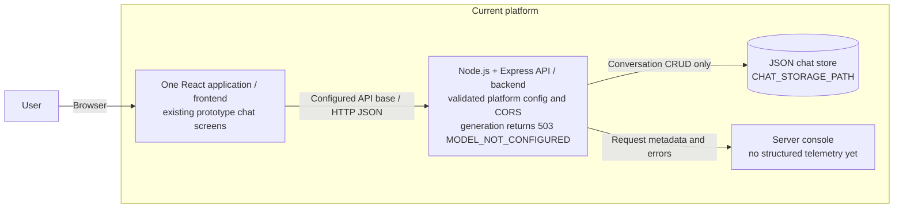
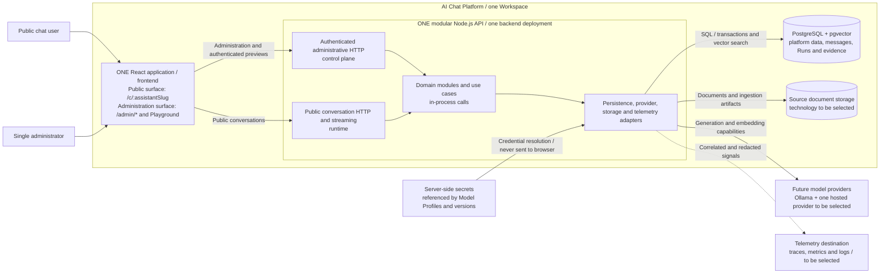
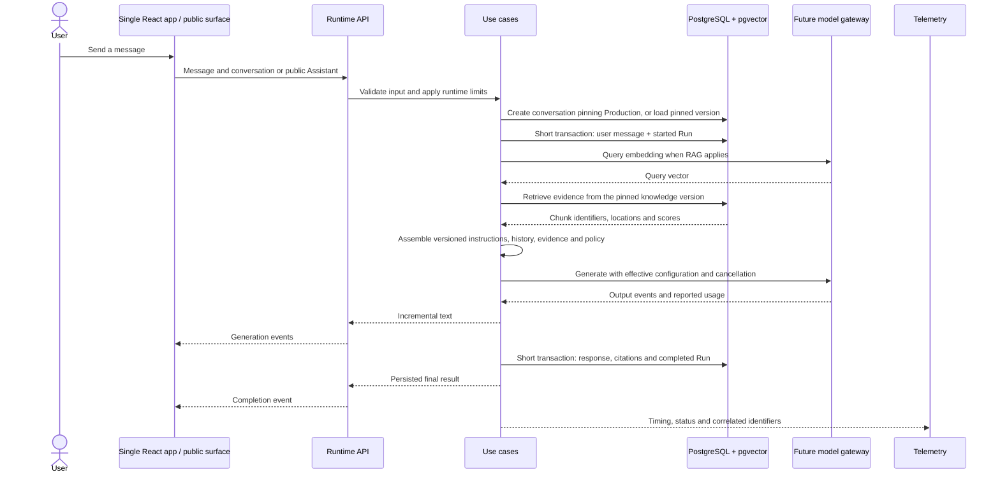

# AI Chat Platform architecture

Date: 2026-10-24. This document reflects the revised P0.3 boundary in the
[roadmap](roadmap.md). It distinguishes implemented platform behavior from the
future MVP. [ADR-001](adr/001-use-modular-monolith.md) records the modular
monolith decision and the single-frontend clarification.

## 1. Current application

The application can start without a model. Conversation list, creation, history
and deletion work; generation returns an explicit 503 without saving input,
fabricating a response or making a provider request. The prototype's direct
Ollama service and global model configuration are removed.

The monorepo contains `frontend/`, `backend/`, `packages/ui/` and
`packages/shared/`. Internal package entry points are still empty. Components
remain in frontend. The current prototype routes have not yet been replaced
by the target public/admin routes. See [internal packages](internal-packages.md).

| Boundary                                                                                                | Implemented responsibility                                                                              |
| ------------------------------------------------------------------------------------------------------- | ------------------------------------------------------------------------------------------------------- |
| [Frontend config](../frontend/src/config/index.ts) and [HTTP service](../frontend/src/services/Chat.ts) | Validated public API base from Vite; generation failures propagate rather than becoming assistant text. |
| [Backend config](../backend/src/config.ts)                                                              | Pure immutable platform configuration; no model or dotenv side effects.                                 |
| [server.ts](../backend/src/server.ts)                                                                   | Executable-only dotenv loading, validation before composition, HTTP startup and shutdown.               |
| [composition.ts](../backend/src/composition.ts)                                                         | Explicit storage construction and initialization; no provider dependency.                               |
| [app.ts](../backend/src/app.ts) and [controller](../backend/src/controllers/ChatController.ts)          | Configured CORS, injected storage methods, CRUD and unconfigured generation state.                      |
| [ChatService.ts](../backend/src/services/ChatService.ts)                                                | In-memory chat state and full JSON-file writes; not yet transactional persistence.                      |

`CHAT_STORAGE_PATH` resolves from the backend package consistently in source and
compiled execution. The JSON store still cannot guarantee concurrent-write
safety or durable error propagation. Authentication, PostgreSQL, RAG, Runs,
versioning, streaming and structured telemetry are future work.

## 2. Target MVP containers

Container diagrams use the abstraction level of
[C4](https://c4model.com/diagrams/container): applications and data stores,
not necessarily Docker containers. Packages and UI surfaces are code boundaries,
not independent deployment units.

The MVP has **one React application with two surfaces**, not two web
applications or deployments. UI reuse through `@chat-app/ui` supports shared
components inside that application. The `/admin/*` route group will require
administrator authentication; `/c/:assistantSlug` is the stable public route.
Those screens and authentication are not introduced by P0.3.

Control plane means configuring and operating the product; runtime means
serving conversations. They have distinct HTTP/access policies inside the same
backend. Playground reuses conversation execution through the authenticated
surface. Neither surface talks directly to private storage or model providers.

PostgreSQL is authoritative for product records. pgvector provides vector
search in the same database. Source documents remain available to rebuild
indexes. Telemetry observes execution but is not the authoritative Run store.
Storage technology, identity flow, the hosted provider, telemetry destination
and cloud services remain decisions for their assigned roadmap tasks.

Development, Staging and Production are Assistant deployment aliases. They do
not require three physical platform deployments for the MVP.

## 3. Configuration ownership and module boundaries

| Owner                                        | Settings and data                                                                                                |
| -------------------------------------------- | ---------------------------------------------------------------------------------------------------------------- |
| Platform environment                         | Node environment, HTTP port, allowed CORS origins and the temporary chat-storage path.                           |
| Persisted Model Profiles, later              | Provider connections, model identity, capabilities and credential references.                                    |
| Assistant Drafts / immutable Versions, later | Instructions, generation parameters, context and guardrail policy, knowledge references and public presentation. |

Provider credentials stay server-side. Assistant Versions snapshot effective
output-affecting configuration and reference credentials rather than copying
secret values. Global platform environment variables do not configure chatbot
instructions, models, generation parameters or embeddings.

Proposed backend modules:

| Module                       | Responsibility and owned data                                                                   |
| ---------------------------- | ----------------------------------------------------------------------------------------------- |
| Identity and Workspace       | Administrator, session, automatic Workspace and access boundaries.                              |
| Assistants and configuration | Assistant, mutable draft, presentation and instructions.                                        |
| Releases                     | Immutable versions, environment aliases and audited promotion/rollback records.                 |
| Models                       | Model Profiles, capability contracts and future provider adapters; interfaces start at P3.1.    |
| Knowledge                    | One base per Assistant; documents, ingestion, chunks, versioned indexes and retrieval evidence. |
| Conversations and runtime    | Conversation, Message and Run; context, budgets, generation, streaming and cancellation.        |
| Inspection and evaluation    | Authorized queries and reproducible evaluation without writing other modules' data.             |

HTTP translates inputs and outputs; use cases coordinate domain rules. Each
module owns its writes and exposes public interfaces. Sharing PostgreSQL allows
coordinated transactions, not arbitrary cross-module table writes.
`@chat-app/shared` is for portable utilities and agreed contracts, not provider
SDKs or persistence entities. Packages do not import applications.

## 4. Principal future flows

### Configure, publish and promote

An administrator edits a Draft and tests its configuration in Playground.
Publishing creates an immutable Assistant Version with effective configuration,
policies and a knowledge/index version reference. Promotion atomically changes
an environment alias and records the actor, time and previous destination.
Rollback creates another Deployment pointing to a compatible published version.

Creating a conversation through `/c/:assistantSlug` resolves Production and
pins `assistantVersionId`. Later promotions affect new conversations; existing
ones retain their version. Previews of other environments or versions require
authentication. Archived, missing and undeployed Assistants have explicit states.

### From a public message to a persisted Run

This sequence is a **future** runtime, not the temporary P0.3 generation endpoint:

Model network calls do not keep SQL transactions open. Runs record effective
version, provider/model identity, evidence, timing, status and available usage,
without hidden reasoning. Failure, timeout and cancellation are explicit
terminal outcomes. Persistence failure must not appear as a saved completion.
Partial-output and interrupted-Run recovery policies belong to persistence and
streaming implementation.

### From documents to versioned knowledge

Authenticated upload validates file type and size, assigns safe storage
locations and records ownership and content hashes. Knowledge preserves source
documents, parses and chunks content, and stores traceable embeddings with
model and dimension metadata. Initial formats are PDF, Markdown and plain text.
Failures are visible and indexes can be rebuilt. Publishing pins knowledge;
later document changes affect the draft, not published versions. Retention
must preserve artifacts required by active versions. Ingestion design does not
imply introducing a broker or another service.

## 5. MVP scope and non-goals

Included: one administrator and one automatic Workspace, multiple Assistants,
drafts and immutable versions, environment aliases, stable public URLs and
authenticated previews; Ollama plus one ADR-selected hosted provider; one
knowledge base per Assistant; RAG with citations; basic guardrails; Run and
conversation inspection; evaluations, telemetry, automated tests, CI/CD and one
deployed environment. None of the future provider functionality is active in
P0.3.

Deferred: functional multitenancy, billing, quotas, complex roles, external
WhatsApp/Slack channels, tools, autonomous agents, human approvals, A/B traffic
and advanced experimentation, multiple bases per Assistant, multi-agent
orchestration, Kubernetes, microservices, Kafka and event sourcing.
`workspaceId` prepares ownership without implementing multitenancy.

Public runtime limits, server-side credentials, configured CORS, retention and
privacy-aware telemetry are target boundaries. Messages and retrieved documents
are untrusted data. Telemetry excludes sensitive content and secrets by default.
Authentication and comprehensive security policies remain in their roadmap tasks.

## References and next steps

[Configuration](configuration.md) documents P0.3 startup and the temporary
unconfigured-model state. [Composition](backend-composition.md) explains
construction and lifecycle. P0.4–P0.6 complete the trustworthy baseline before
domain work; P1.3/P1.4 decide contracts and validation, P2.1 data access, P3.1
the model interface, P3.7 the hosted provider, P4.1 authentication, P6.1 ingestion
and P8.2 cloud architecture.

Official references: [C4 containers](https://c4model.com/diagrams/container),
[ADRs](https://adr.github.io/), [pgvector](https://github.com/pgvector/pgvector),
[OpenTelemetry signals](https://opentelemetry.io/docs/concepts/signals/).
