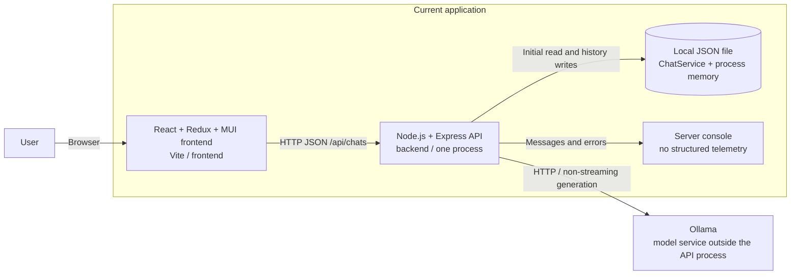
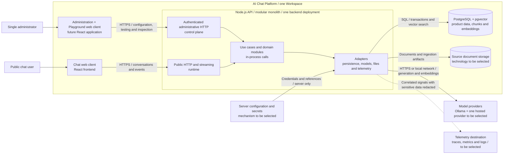
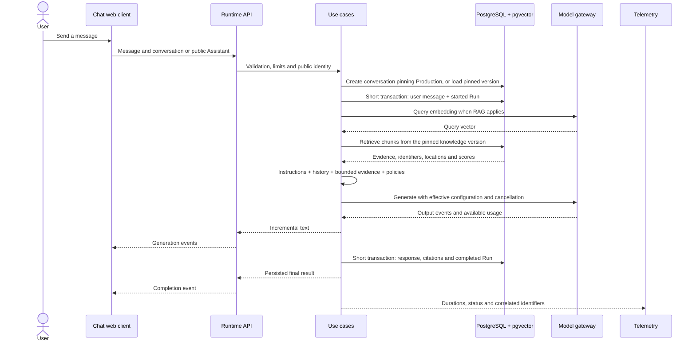

# AI Chat Platform architecture

Date: 2026-10-24. Task: **P0.1** in the [roadmap](roadmap.md).
The current architecture was checked against revision `660e807`; the target
architecture guides subsequent tasks and has not been implemented yet.

The platform will evolve toward **one API deployed as a modular monolith**,
with two web clients: public chat and administration. The decision and its
alternatives are recorded in [ADR-001](adr/001-use-modular-monolith.md).

## Reading the diagrams

The container views follow the abstraction level of
[C4](https://c4model.com/diagrams/container): applications and data stores,
which do not necessarily correspond to Docker containers. Arrows represent
communication, with labels describing its purpose. Modules and packages are
code boundaries; they do not imply independent processes or deployments.

## 1. Current architecture: chat prototype

The monorepo contains `frontend/`, `backend/`, `packages/ui/` and
`packages/shared/`. Both internal packages are linked, but their entry points
are empty. Components still live in the frontend; the admin application does
not exist yet. See the [internal package configuration](internal-packages.md).

Evidence of current responsibilities:

| Code                                                                                                                       | Observed behavior                                                                                               |
| -------------------------------------------------------------------------------------------------------------------------- | --------------------------------------------------------------------------------------------------------------- |
| [App.tsx](../frontend/src/App.tsx) and [Chat.ts](../frontend/src/store/reducers/Chat.ts)                                   | Chat routes and Redux state; adds user messages before receiving the response.                                  |
| [Frontend HTTP service](../frontend/src/services/Chat.ts)                                                                  | Axios uses a hard-coded local URL; some errors become empty lists or response text.                             |
| [server.ts](../backend/src/server.ts)                                                                                      | Configures Express, unrestricted CORS, routes and error handling; opens a port when imported.                   |
| [ChatRoutes.ts](../backend/src/routes/ChatRoutes.ts) and [ChatController.ts](../backend/src/controllers/ChatController.ts) | Chat CRUD and message orchestration; imports global service instances.                                          |
| [ChatService.ts](../backend/src/services/ChatService.ts)                                                                   | Holds chats in memory, starts an asynchronous load and writes JSON; logs write errors without propagating them. |
| [OllamaService.ts](../backend/src/services/OllamaService.ts)                                                               | Reads configuration during construction, transforms history and calls Ollama directly with `stream: false`.     |

Current message flow: the browser sends `chatId` and `message`; the controller
saves the user message, retrieves history, requests an Ollama response and saves
that response before returning JSON. The route also contains `:chatId`, but
the controller reads the identifier from the body.

This does not yet guarantee durability or ordering under concurrency: writes
replace the full history, and failures can remain hidden. There is no Run
entity, versioning, RAG, authentication, streaming or tracing. Current logging
includes chat content; the target policy excludes it by default.

## 2. Target MVP architecture

The control plane **configures and operates** the product; the runtime
**serves conversations**. They will have separate routes and access policies
while sharing the backend process and the necessary use cases. Playground
uses the authenticated surface and reuses the conversation engine. Public
chat never accesses PostgreSQL, private documents, credentials or provider
endpoints directly.

PostgreSQL is the authoritative store for entities and execution records;
pgvector adds vector search inside that database rather than introducing
another service. Source files must be retained to rebuild indexes. Storage
technology, administrator identity, the hosted provider and the telemetry
destination will be selected in their respective tasks; this diagram does
not select AWS services.

Development, Staging and Production aliases belong to each Assistant's domain.
They do not require three physical platform deployments for the MVP.

## 3. Module boundaries and dependencies

These are proposed logical boundaries for organizing the backend, not folders
or services created by this task:

| Module                       | Responsibility and owned data                                                                          |
| ---------------------------- | ------------------------------------------------------------------------------------------------------ |
| Identity and Workspace       | Administrator, session and automatically created Workspace; access boundaries.                         |
| Assistants and configuration | Assistant, mutable draft, presentation and instructions.                                               |
| Releases                     | Immutable versions, environment aliases and audited promotion or rollback records.                     |
| Models                       | Model Profiles, generation and embedding contracts, capabilities and provider adapters.                |
| Knowledge                    | One knowledge base per Assistant; documents, ingestion, chunks, index versions and evidence retrieval. |
| Conversations and runtime    | Conversation, Message and Run; context, budgets, streaming, cancellation and execution policies.       |
| Inspection and evaluation    | Authorized conversation/Run queries and reproducible evaluation; does not rewrite other modules' data. |

Dependency rules:

- HTTP translates inputs and outputs; use cases coordinate domain rules.
  Persistence and providers connect through explicit interfaces at the
  application composition boundary.
- Each module owns its writes. Other modules use its public interface rather
  than accessing its tables directly or importing implementation details.
  A shared database allows transactions across coordinated operations.
- `@chat-app/ui` will contain React presentation reusable by chat and admin;
  it will not access storage, secrets or backend services directly.
- `@chat-app/shared` will contain portable utilities and agreed contracts;
  it will not hold repositories, provider SDKs or persistence entities.
  The contract strategy will be decided in P1.3.
- Applications consume packages; packages do not import applications. Sharing
  TypeScript does not replace validation of data received at runtime.
- Telemetry observes operations. Product Run records do not depend on the
  availability of the telemetry exporter.

## 4. Principal target flows

### Configure, publish and promote

The administrator edits the draft and tests a configuration snapshot in
Playground, with conversations identified as tests. Publishing creates an
immutable Assistant Version containing effective configuration, policies and
a knowledge version reference; it never includes secret values. Promotion
atomically changes the environment alias and creates a Deployment record with
the actor, timestamp and previous target. Rollback creates another Deployment
pointing to a compatible published version.

`/c/:assistantSlug` is the stable public URL: creating a conversation resolves
Production and pins `assistantVersionId`. A subsequent promotion affects new
conversations; existing ones retain their version. Previews of other versions
or environments require authentication. An archived, missing or unpublished
Assistant has an explicit public state.

### From a public message to a persisted Run

The diagram shows the successful path. Network calls to the model do not hold
an SQL transaction open. Each Run records the effective version, provider and
model, retrieved evidence, timing, status and reported usage when available.
Inspection joins these records by identifier without storing hidden reasoning.

Validation failures, missing deployments and access denial are rejected before
generation. Failure, timeout and cancellation are explicit Run outcomes rather
than fabricated Assistant answers. Disconnection must cancel upstream
generation. Partial-output policy and recovery of interrupted Runs will be
defined when persistence and streaming are implemented. Persistence failure
must not be presented as a successfully saved completion.

### From documents to versioned knowledge

An authenticated upload validates type and size and assigns a storage location
independent of the supplied filename. Knowledge records ownership, hash and
state, preserves the source document and performs traceable parsing, chunking
and embedding generation. Chunks retain document and source-location references;
embeddings record the model and dimensions. The index can be rebuilt, and
failures are visible. Planned initial formats are PDF, Markdown and plain text
(P6.1).

Publishing pins an index version. Document changes affect the draft without
changing the evidence available to published versions. Source and index
retention must preserve active versions and explicitly report the unavailability
of deleted artifacts. Recoverable ingestion execution will be designed in
P6.1; this task introduces neither a broker nor another service.

## 5. MVP scope and boundaries

The MVP includes one administrator and an automatic Workspace, multiple
Assistants, drafts, immutable versions, Development/Staging/Production aliases,
a stable public URL and authenticated previews. It includes Ollama and one
hosted provider selected through an ADR, one knowledge base per Assistant,
RAG with citations, basic guardrails and inspection of conversations, evidence,
latency, usage and failures. Evaluations, telemetry, tests, CI/CD and one
deployed environment are part of the outcome, beyond the chat screens.

Deferred capabilities are functional multitenancy, billing, quotas, complex
roles, WhatsApp/Slack channels, tools, autonomous agents, human approvals,
A/B traffic splitting and advanced experimentation, multiple knowledge bases
per Assistant, multi-agent orchestration, Kubernetes, microservices, Kafka
and event sourcing. Representing `workspaceId` prepares future ownership;
it does not implement multitenancy.

Target public boundaries include administrative authentication, runtime rate
and payload limits, server-only credentials and environment-specific CORS.
Documents and messages are untrusted inputs. Telemetry excludes personal
content, retrieved text, access tokens and secrets by default; retention and
visibility require explicit policies. Details and tests will be added in the
configuration and authentication tasks and phase 7.

## 6. Next steps and open decisions

This task produces documentation. P0.2 will separate Express construction from
startup and make dependency composition explicit; P0.3 will validate
configuration; P0.4–P0.6 will add tests and complete quality gates before domain
work. The roadmap's task order and phase exit gates remain in effect.

Decisions remain in their respective ADRs or tasks: HTTP contracts (P1.3),
PostgreSQL data access (P2.1), hosted provider (P3.7), authentication flow
(P4.1), ingestion and index versioning (P6.1), telemetry destination (P7),
and AWS services/cost (P8.2). Admin creation and UI extraction will be
coordinated with phase 4.

Official references consulted: [C4 containers](https://c4model.com/diagrams/container),
[ADRs](https://adr.github.io/), [pgvector](https://github.com/pgvector/pgvector)
and [OpenTelemetry signals](https://opentelemetry.io/docs/concepts/signals/).

## P0.1 verification

- Current and target diagrams show frontend, API, storage, model and telemetry
  boundaries.
- Current behavior is checked against linked source files; proposals are marked
  as future work, and internal packages are represented as code dependencies.
- Publishing, conversation/Run and ingestion flows include version invariants.
- Included scope and deferred capabilities match the roadmap.
- [ADR-001](adr/001-use-modular-monolith.md) records the decision, alternatives,
  consequences and conditions for reconsidering it.
