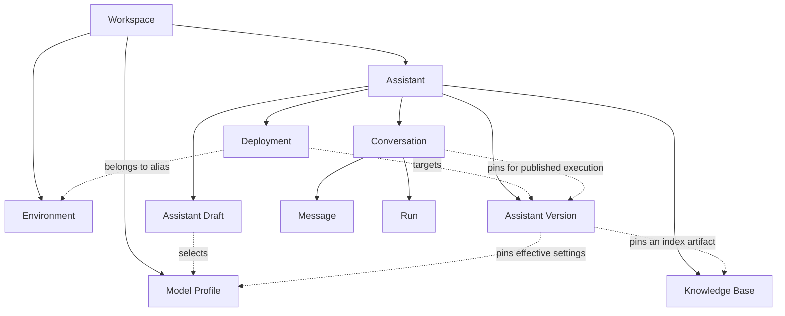

# Platform domain glossary and ownership

**Status:** P1.1 target product model, October 26, 2026. This document defines
language and invariants for subsequent implementation; it does not introduce
entities, database tables, routes or provider interfaces into the prototype.
See the [architecture](architecture.md), [configuration ownership](configuration.md),
[state transitions](lifecycle.md) and [execution roadmap](roadmap.md).

## Vocabulary and scope

An **Assistant** is the configurable chatbot product. A **Conversation** is one
interaction history with that product. A **Message** is a persisted contribution
to that history. A **Run** records an execution that tries to produce an answer.
These are different identities and lifecycles.

Use these canonical names in new domain documentation, contracts and code.
“Chat” may remain a user-facing label or an explicitly legacy identifier; it
must not name a new domain entity that could mean either an Assistant or a
Conversation. “Bot” is not another entity alongside Assistant.

The MVP has one administrator, one automatically created Workspace and one
React application with public and administration surfaces. The API remains a
modular monolith. Logical boundaries below do not imply new services, frontend
applications, queues or tenant-management features.

## Glossary and lifecycle intent

Lifecycle descriptions here identify what can change. [P1.2 lifecycle rules](lifecycle.md)
define states, transitions, admission guards and failure recovery; these glossary
paragraphs are not state-machine enums.

### Workspace

The persistent ownership scope for platform records and administrator access.
The default Workspace is bootstrapped once through the future seed process;
restarting the API must not create a new ownership scope or replace its identity.
Workspace metadata can change without changing its identifier. Workspace
provisioning, switching, invitations and deletion are not MVP user flows.

### Assistant

A long-lived product identity within a Workspace, with a name and stable public
slug. It groups configuration, releases, knowledge and conversation history.
Its metadata and archive status are mutable. Creation starts configuration;
publication and promotion make releases usable. Archive is reversible and does
not delete versions or conversation history. Exact admission behavior for
archived Assistants is specified with lifecycle policies in P1.2.

The slug identifies the Assistant, not a release or conversation. It is unique
within the default Workspace and remains stable across promotions and rollbacks.
The single-Workspace public resolver has no tenant selector. Future multitenant
routing and slug uniqueness are separate decisions, not capabilities supplied
by adding `workspaceId`.

### Assistant Draft

The Assistant's editable configuration, with one current Draft per Assistant.
It holds instructions, a Model Profile selection, generation/context settings,
knowledge selection, guardrails and public presentation. Editing and saving
change the Draft. Publishing reads a consistent snapshot and creates a separate
Assistant Version; the Draft remains available for further editing. Saving a
Draft never updates an existing published Version. Concurrency control and
validation are specified in subsequent contract and persistence work.

### Assistant Version

An immutable published release belonging to one Assistant. It captures effective
output-affecting configuration and release provenance, including resolved model
settings, instructions, generation/context policies, presentation and any pinned
knowledge/index reference. The version identity and release order are scoped to
that Assistant; identifier syntax and physical storage are later decisions.

Publication creates the record; promotion and Conversations reference it. It is
never edited into a new release. A change requires publishing another Version.
Retain referenced versions and their required artifacts; physical deletion and
retention policies must not leave existing records with dangling references.
Immutability supports configuration traceability, not a promise of identical
model output or permanent availability of an external provider/model.

### Environment

A named release alias scope: **Development**, **Staging** or **Production**.
The default Workspace owns this fixed MVP set. Each Assistant resolves its own
active Deployment in an Environment; Environment is not one global version
pointer shared by all Assistants. A pair of Assistant and Environment can have
no deployment yet, or one active deployment.

Environment identity and meaning remain stable while deployment destinations
change. These aliases are not `NODE_ENV`, env files, separate databases or three
physical platform installations. Adding configurable environments is deferred.

### Deployment

An immutable audit record of promoting a published Assistant Version into one
Environment. It records the Assistant, Environment, target Version, actor, time
and prior deployment reference when one exists. All referenced records belong
to the same Workspace, and the Version belongs to that Assistant.

Promotion appends a Deployment and atomically changes the active lookup for the
Assistant/Environment pair. “Active” is a relationship to that lookup, not a
reason to rewrite old audit records. Rollback appends another Deployment pointing
to a retained compatible Version; it does not erase history or modify a Version.
The lookup's concrete representation and transaction constraints belong to P2.

### Model Profile

A Workspace-owned, reusable provider/model configuration managed by the Models
module. It describes provider and model identity, connection/endpoint settings
or references, capabilities, allowed defaults and server-side credential
references. Several Assistants can select the same Profile. It does not own
Assistant instructions, conversation history or application deployment settings.

Profiles can be created, tested and edited, then retired from new selections.
Editing a Profile may affect future Draft resolution and publication, but must
not silently retarget a published Version or an existing Conversation. A
published Version therefore needs resolved immutable effective settings or an
immutable configuration reference; a live `modelProfileId` alone is insufficient.
The exact snapshot/revision representation remains future persistence work.

Credential values remain outside Drafts, Versions, public payloads and this
profile's readable configuration. References resolve through a server-side
secret boundary. Rotation or revocation can affect availability without rewriting
historical configuration. A profile name does not prove connectivity, capability
support or model availability.

### Knowledge Base

The Assistant-owned collection of source documents and derived knowledge used
for retrieval. An Assistant has at most one Knowledge Base in the MVP; a Version
can operate without knowledge. Multiple bases per Assistant are deferred.

The collection is mutable: documents can be uploaded, processed, replaced or
removed, producing derived indexes and visible ingestion outcomes. A published
Version pins a specific ready knowledge/index artifact, not the collection's
mutable latest state. Subsequent ingestion changes the Draft's available
knowledge, not that Version. Referenced artifacts must be retained. [P1.2](lifecycle.md#documents-and-knowledge-ingestion)
outlines Document transitions; P6.1 refines chunk/index lifecycles, storage,
deduplication and retention.

### Conversation

One ordered interaction history belonging to an Assistant and Workspace. Its
execution target is fixed when the Conversation begins. Message history can grow
and lifecycle metadata can change; later promotions do not retarget it.

Public creation through `/c/:assistantSlug` resolves the Assistant's current
Production deployment once and pins `assistantVersionId`. Authenticated previews
of published versions likewise pin the selected Version. Missing, archived and
undeployed cases require explicit policies, not a fallback model or release.
Closing or retaining a Conversation is distinct from deleting its Assistant.

Draft Playground sessions are an explicit exception to published-version
selection: they capture an immutable effective Draft snapshot for that session,
without publishing or inventing an `assistantVersionId`. They remain marked as
preview traffic and separate from public conversations. Testing changed Draft
settings starts a new snapshot/session. Exact target discrimination and snapshot
storage belong to P1.2/P1.3 and Playground implementation.

### Message

A persisted user input or assistant response within a Conversation, with stable
identity and deterministic conversation order. Its accepted content and sender
are immutable during normal operation. A user input becomes durable through the
runtime acceptance transaction; a successful answer becomes durable through the
completion transaction. Validation and rejected requests need not create a
Message. Future retention/redaction policies are explicit operations, not edits
that silently change execution history.

Every persisted assistant response references exactly one successful producing
Run. A successful Run confirms at most one such Message; nonterminal, failed,
cancelled and expired Runs confirm none. The association and success are committed
atomically; see [response provenance](lifecycle.md#response-provenance-and-cardinality).

Instructions belong to configuration, not a separate user-visible “system”
Message. Streamed fragments are execution events, not automatically committed
assistant Messages. A model/dependency failure is not assistant text. The current
frontend's optimistic user bubble is not proof of persistence.

### Run

The persisted record of one platform generation execution for a Conversation's
accepted user Message. It includes retrieval when applicable and records the
pinned target/effective configuration, model/provider identity, evidence, timing,
status, usage when available, and safe error metadata. It is not a synonym for
an HTTP request, telemetry trace or individual provider HTTP attempt.

A Run is created at acceptance, updated while executing and finalized with a
`succeeded`, `failed`, `cancelled` or `expired` (deadline/timeout) outcome.
Identity, ownership, triggering Message and target remain fixed; terminal results are not rewritten by retries.
An explicit retry creates a new Run. Provider-internal retry accounting and
client request idempotency are later runtime/contract decisions.

A succeeded Run produces at most one committed assistant answer in this MVP.
Every such answer belongs to exactly that Run. A failed, cancelled or expired
Run produces no committed assistant answer; streamed partial output is not a
confirmed Message. One user Message can be associated with multiple Runs through
explicit retries. Preserve these relationships when inspecting failures or
partial output. PostgreSQL is the future authoritative record; telemetry is
correlated observation. Never store credentials or hidden model reasoning in a
Run, and do not report unavailable usage as measured zero.

## Ownership and mutability map

Ownership has three distinct meanings:

- **Workspace scope:** whose records may be associated or accessed together.
- **Domain parent:** which product identity a record belongs to.
- **Write owner:** the single module responsible for changing that record.

An administrator or visitor is an actor, not a substitute for any of these
owners. Inspection/evaluation reads through module interfaces and owns no writes
to the entities listed below.

| Entity            | Domain parent                               | Write owner                  | Mutation rule                                                                |
| ----------------- | ------------------------------------------- | ---------------------------- | ---------------------------------------------------------------------------- |
| Workspace         | Platform bootstrap                          | Identity and Workspace       | Stable identity; mutable metadata.                                           |
| Assistant         | Workspace                                   | Assistants and configuration | Mutable metadata/archive state.                                              |
| Assistant Draft   | Assistant                                   | Assistants and configuration | Mutable; one current Draft.                                                  |
| Assistant Version | Assistant                                   | Releases                     | Immutable after publication.                                                 |
| Environment       | Workspace                                   | Releases                     | Fixed MVP identity/meaning; destinations belong to the per-Assistant lookup. |
| Deployment        | Assistant; references Environment           | Releases                     | Append-only audit record; active lookup changes atomically.                  |
| Model Profile     | Workspace                                   | Models                       | Mutable for future resolution; published effective settings stay fixed.      |
| Knowledge Base    | Assistant                                   | Knowledge                    | Mutable collection; pinned index artifacts stay fixed.                       |
| Conversation      | Assistant                                   | Conversations and runtime    | Mutable lifecycle/history; immutable execution target.                       |
| Message           | Conversation                                | Conversations and runtime    | Append-only accepted content and order during normal operation.              |
| Run               | Conversation; references triggering Message | Conversations and runtime    | Mutable while active; immutable target and terminal result.                  |

These relationships are not an ORM schema or a requirement to load every child
into an Assistant/Workspace aggregate. A consistency boundary groups rules that
must hold together. Use cases coordinate cross-module rules through explicit
interfaces and transactions where needed; sharing a database does not authorize
one module to update another module's tables.

Solid arrows show ownership. Dashed arrows show references, not write access.
The Profile/Knowledge references on Version mean immutable effective settings
and index artifacts, not resolving mutable latest configuration at execution.
The diagram omits repeated Workspace references; the scoping rules below apply
to every record.

## Workspace invariants without multitenancy

Workspace itself uses its `id` as the scope identifier; it does not need a
self-referencing `workspaceId`. Every other entity above carries `workspaceId`
in the target model, even where the parent also implies ownership.

1. Use the persisted default Workspace in the MVP; do not create a Workspace
   per Assistant, administrator request, conversation or API restart.
2. Resolve scope through the server's configured/authenticated context or the
   trusted public Assistant lookup. A caller-supplied `workspaceId` does not
   grant access or override that context.
3. Every parent and reference must have the same Workspace. Additionally, a
   Draft, Version, Deployment and Conversation must agree on their Assistant;
   Messages and Runs must agree on their Conversation and pinned target.
4. A Model Profile is reusable only inside its Workspace. A Knowledge Base
   belongs to its Assistant; publishing cannot attach another Assistant's
   knowledge simply because both are in the same Workspace.
5. Preserve scope in reads and writes. Future database constraints and use cases
   must reject inconsistent references; a UUID or foreign key alone is not an
   authorization policy.
6. Do not add tenant selection, provisioning APIs, invitations, billing, quotas,
   roles or isolated tenant deployments in this task. `workspaceId` is explicit
   ownership preparation, not implemented multitenancy or authentication.

## Configuration resolution and stable behavior

| Configuration owner                 | Changes affect                                                          | Must not change implicitly                                        |
| ----------------------------------- | ----------------------------------------------------------------------- | ----------------------------------------------------------------- |
| Platform deployment                 | Listener, CORS, node environment and current file storage.              | Assistant instructions, model selection or generation parameters. |
| Model Profile                       | Future Draft/profile resolution and newly published effective settings. | Existing Versions and pinned Conversations.                       |
| Assistant Draft                     | Future snapshots, publication and new Draft Playground sessions.        | Published releases and existing sessions.                         |
| Assistant Version                   | No in-place configuration changes.                                      | Its instructions, effective model settings or pinned knowledge.   |
| Assistant/Environment active lookup | Which Version new conversations resolve.                                | The Version itself or existing Conversation targets.              |

For example, Assistant `support` in Workspace `default` publishes Versions 1
and 2. Production initially resolves Version 1, so Conversation A pins it.
Promoting Version 2 appends a Deployment; a new Conversation B pins Version 2,
while A stays on Version 1. Rolling back appends another Deployment to Version
1, and only newly created conversations resolve that destination. Editing a
shared Model Profile or ingesting new documents cannot rewrite either Version.

## Prototype mapping and subsequent work

| Existing prototype name or behavior           | Domain interpretation                                                   | Follow-up                                                                           |
| --------------------------------------------- | ----------------------------------------------------------------------- | ----------------------------------------------------------------------------------- |
| Frontend UI `Chat` components and `/chat/:id` | User-facing label for a Conversation, not Assistant.                    | API, contracts and services use Conversation since P1.5; screens are rebuilt in P4. |
| `Message.role: "assistant"`                   | Assistant-authored content; replaced `sender: "bot"` in P1.5.           | Done.                                                                               |
| JSON chats with title and messages            | Prototype histories with no Assistant, Workspace or pinned Version.     | Do not claim the new ownership model is already enforced.                           |
| `503 MODEL_NOT_CONFIGURED`                    | Deliberately unavailable execution before Model Profiles/Model Gateway. | No new Run, saved question, fallback provider or fabricated answer in this task.    |

P1.1 does not add migrations, entities in `@chat-app/shared`, API DTOs,
authentication, provider interfaces or new screens. P1.2 defines state machines,
P1.3 selects contract ownership and identifier conventions, P2 implements
persistence, P3 introduces the model gateway, and P4–P6 deliver administration,
release flows and knowledge. Retention/redaction, provider availability and
credential rotation can constrain reproducibility; the glossary does not claim
to implement those policies.

References: [Ubiquitous Language](https://martinfowler.com/bliki/UbiquitousLanguage.html),
[domain analysis](https://learn.microsoft.com/en-us/azure/architecture/microservices/model/domain-analysis)
and [the existing modular-monolith decision](adr/001-use-modular-monolith.md).
