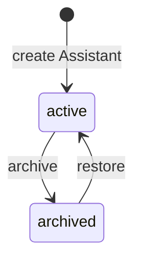
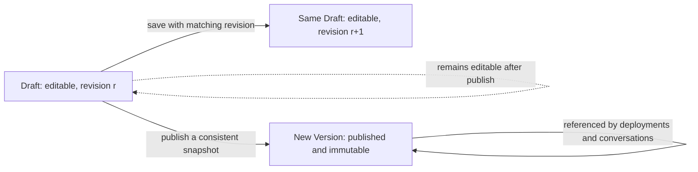
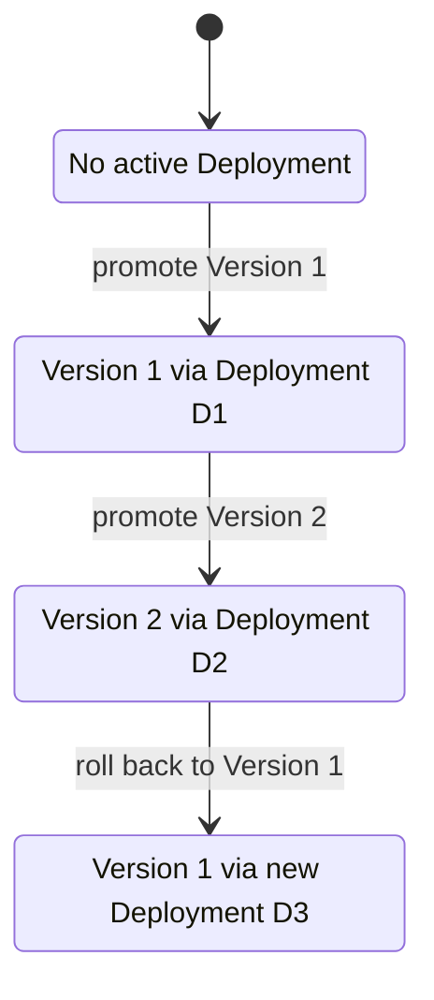
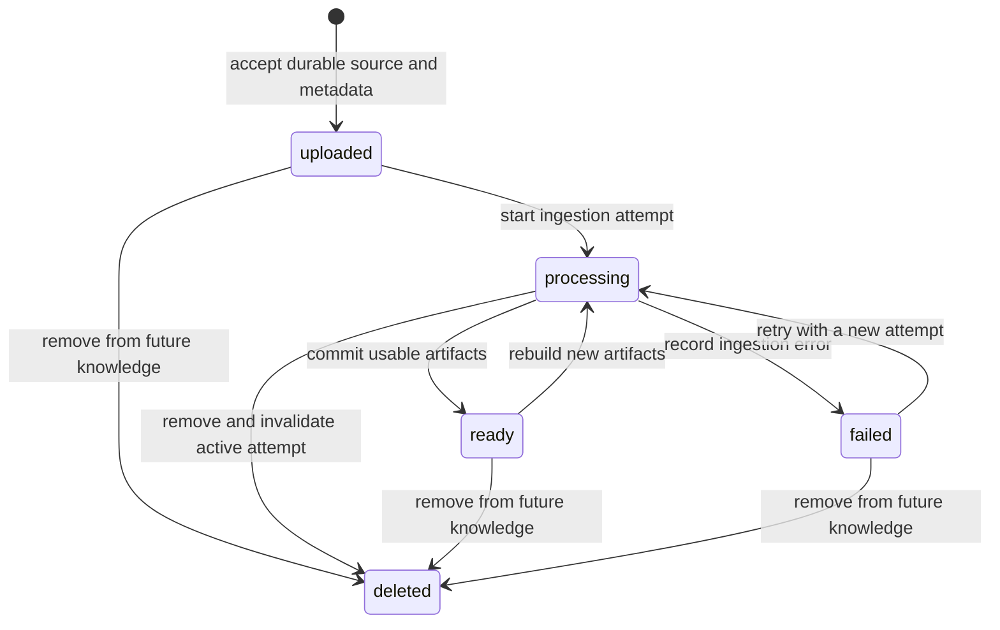
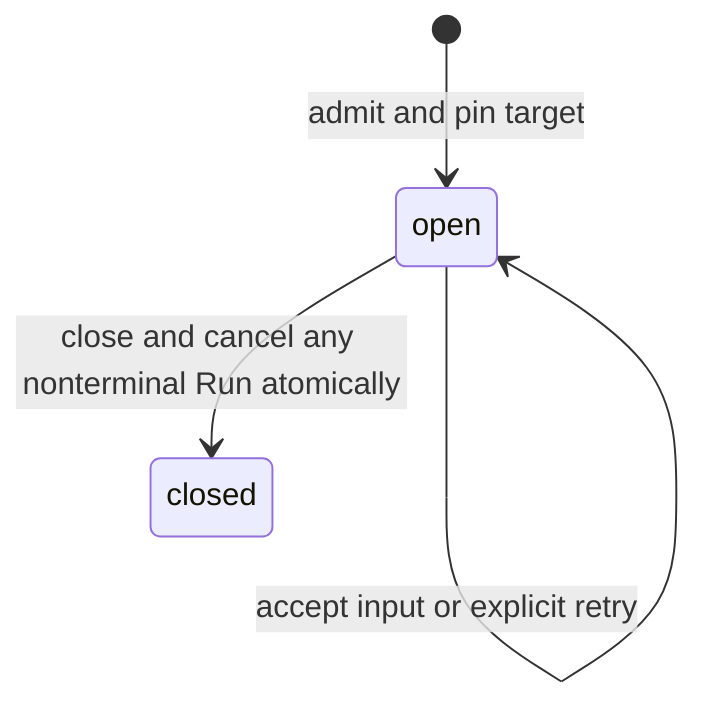
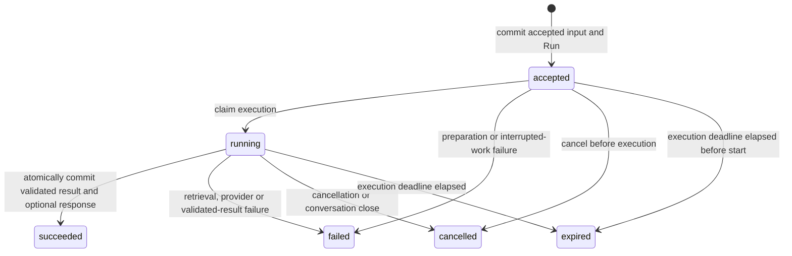

# Platform lifecycle states and invariants

**Status:** P1.2 target behavior, October 26, 2026. This document complements the
[domain glossary](domain.md). It specifies lifecycle rules for future use cases
and persistence; no state enums, database constraints, provider contracts or
runtime behavior are implemented by this documentation change.

## How to read the model

A transition has a source state, a command/event, guards that must hold, and an
atomic durable result. A failed guard leaves durable state unchanged. A network
response or streamed token does not, by itself, prove a committed transition.
State labels below are domain vocabulary; P1.3/P1.4 define wire names, schemas
and error codes. All operations preserve the glossary's Workspace, Assistant
and Conversation ownership rules.

| Object                     | Lifecycle state                                                      | Properties that never change in place                       |
| -------------------------- | -------------------------------------------------------------------- | ----------------------------------------------------------- |
| Assistant                  | `active`, `archived`                                                 | Identity, Workspace and stable slug.                        |
| Draft                      | `editable`; revision changes on save                                 | Assistant and Workspace; captured snapshots.                |
| Version                    | `published`                                                          | Published configuration, provenance and pinned artifacts.   |
| Environment lookup         | Undeployed or points to one Deployment                               | Workspace/Assistant/Environment scope.                      |
| Deployment                 | Recorded; current/historical is derived from lookup                  | Actor, target Version, prior reference and time.            |
| Document                   | `uploaded`, `processing`, `ready`, `failed`, `deleted`               | Content identity and artifacts already pinned by a Version. |
| Conversation               | `open`, `closed`                                                     | Owner and execution target fixed at creation.               |
| Run                        | `accepted`, `running`, `succeeded`, `failed`, `cancelled`, `expired` | Owner, triggering user Message and execution target.        |
| Assistant response Message | Absent or committed; no provisional Message state                    | Producing Run, Conversation, accepted content and order.    |

A Version is not “staging” or “production”; those labels describe environment
lookups. A Deployment is not edited from active to historical; the lookup moves.
A Draft is not turned into a Version; publishing creates a different record.

## Assistant availability

Archive is reversible. The MVP policy is to reject new Conversations, Runs,
Draft edits, publication and promotion for an archived Assistant. Reading history
and restoring the Assistant remain available through authorized administration.
Archive neither deletes history nor implicitly closes existing Conversations.

Admission and archive checks must be serialized: work accepted before archive
may finish under its pinned target; archive does not implicitly cancel that Run.
Cancellation is a separate action. After restore, an open Conversation can use
its original target again, subject to availability and normal admission guards.

## Draft editing and Version publication

The revision marker identifies which saved configuration a command read; it does
not require retaining every historical Draft revision as a new domain entity.
Draft completeness/validity is derived from configuration and references, not a
release state. An incomplete Draft may be saved when its structure is valid;
it cannot be published until the publication guards pass.

| Command                | Guards                                                                                                                                                                                                                                                       | Durable result                                                                                                                       |
| ---------------------- | ------------------------------------------------------------------------------------------------------------------------------------------------------------------------------------------------------------------------------------------------------------ | ------------------------------------------------------------------------------------------------------------------------------------ |
| Save Draft             | Authorized scope, active Assistant, valid editable fields, expected revision still current.                                                                                                                                                                  | Save changes and advance the revision; do not mutate any Version or Playground snapshot.                                             |
| Publish                | Active Assistant; current expected Draft revision; valid effective instructions/parameters; supported Model Profile settings and credential references; selected knowledge/index artifact ready, retained and consistent with the saved knowledge selection. | Create one immutable Version with release order and a consistent effective snapshot. Draft remains editable and aliases do not move. |
| Start Draft Playground | Authorized administrator, active Assistant, valid effective Draft configuration.                                                                                                                                                                             | Create an open preview Conversation with a fixed snapshot; no published Version is invented.                                         |

Publication must not combine instructions from one revision with provider or
knowledge settings read after they changed. Resolve configuration consistently
and recheck concurrency guards before committing. Exact revision/snapshot
storage and database enforcement belong to P2; no provider call is held inside
a database transaction. A valid profile reference does not guarantee that an
external provider remains reachable afterward.

A failed publication exposes no partial Version or moved alias. Version order
does not require gapless allocation of identifiers. Live connectivity failures
do not rewrite an existing release. Changing the Draft or Profile later requires a new snapshot/publication to change
execution settings. Partial-output behavior is never a way to edit a Version.

## Promotion and rollback

This diagram describes one Assistant/Environment lookup, not mutations to the
three Deployment records or either Version:

Promotion requires an active Assistant, authorized actor, a published compatible
Version belonging to that Assistant/Workspace, and retained required artifacts.
The command must agree with the expected current deployment reference. One short
transaction appends the immutable Deployment and moves the scoped lookup.
Failure commits neither change. Other Assistants and Environments are unaffected.

Rollback uses the same write boundary and guards. It creates a new Deployment
targeting a retained compatible published Version; it never reactivates an old
audit record by editing it. Existing Conversations keep their original target.
Replaying the same logical command must not append duplicate audit records;
P1.3 defines request identity and conflict representation.

There is at most one active lookup destination per Assistant/Environment.
Concurrent promotions cannot silently overwrite one another: one wins the
expected-reference check and the other must be rejected or explicitly retried
after reading the new destination. No MVP undeploy/unpublish command is implied.
An Assistant can be undeployed until its first promotion; rollback cannot target
an absent or deleted Version.

## Documents and knowledge ingestion

- `uploaded` requires accepted source bytes, content identity and ownership.
  Rejected file input or a failed upload commit does not create a usable Document.
- `processing` identifies the current ingestion attempt. Errors produce `failed`
  with safe metadata; retry starts a new attempt and preserves failure provenance.
- `ready` requires completed, committed artifacts. A partial chunk/embedding set
  is not ready. Publication must select a ready index snapshot, not merely assume
  that a Document's state proves the entire Knowledge Base is indexed.
- Rebuild creates new derived artifacts. It does not overwrite an index already
  pinned by a published Version, even while the latest ingestion is processing
  or fails. Changing source content requires a new content identity/revision.
- `deleted` is a logical tombstone for future selection/index builds. A new
  publication must not reuse an index inconsistent with the current saved
  selection; rollback to an existing retained Version preserves its old snapshot.
  Deletion is not physical erasure or revocation of artifacts retained by existing
  Versions. Referenced artifacts remain readable under their retention policy. Privacy erasure and
  retention exceptions need explicit later policies, not silent history edits.
- Deleting while processing invalidates the current attempt. A late completion
  cannot change `deleted` back to `ready` or activate its staged artifacts.
  Attempt identity/concurrency guards prevent stale workers from committing.

The MVP does not restore a deleted Document in place; a new upload is a new
content entry. P6.1 refines source/index representation, deduplication, cleanup
and retention without weakening pinned-Version or late-completion guarantees.
No queue, worker deployment or ingestion implementation is introduced here.

## Conversation creation, pinning and close

Creation fixes exactly one target kind for the entire Conversation:

| Entry point                     | Resolution at creation                                               | Fixed target afterward                                                       |
| ------------------------------- | -------------------------------------------------------------------- | ---------------------------------------------------------------------------- |
| Public Assistant URL            | Resolve trusted Assistant slug and its active Production Deployment. | Published `assistantVersionId`; no client-selected alternative Version.      |
| Authenticated published preview | Resolve authorized Environment or explicit published Version.        | That published Version; mark traffic as preview.                             |
| Authenticated Draft Playground  | Validate and capture the effective saved Draft.                      | Immutable Draft snapshot; no invented `assistantVersionId`; mark as preview. |

Creation and promotion races must resolve one complete committed destination,
never mixed configuration. Each Run uses the stored Conversation target instead
of resolving the current alias, latest Profile or live Draft again. Editing a
Draft requires a new Playground session to test the changes.

An open Conversation can admit work only for an active Assistant, under valid
access/limits and with its pinned dependencies available. The MVP permits at
most one nonterminal Run per Conversation; a concurrent new input is rejected
before persisting another user Message/Run. There is no implicit request queue.
An idempotent replay returns its existing result instead of creating new work.

Closing is terminal for the Conversation in this MVP. It atomically marks the
Conversation closed and any nonterminal Run cancelled, without modifying already
terminal Runs. Provider abort follows outside the transaction. Closing does not
erase Messages, release the pinned target or move an alias. Reads remain subject
to authorization/retention. Continuing a closed Conversation requires starting
a new one, not reopening or retargeting it.

## Run execution and terminal outcomes

Only `accepted` and `running` are nonterminal. The other four states are terminal
and have no outgoing transitions. `expired` means a deadline/timeout outcome;
it is distinct from explicit cancellation and an execution error. It does not
mean that retained conversation data has reached its deletion date.

| Transition                 | Required guard/effect                                                                                                                                                                                                                   |
| -------------------------- | --------------------------------------------------------------------------------------------------------------------------------------------------------------------------------------------------------------------------------------- |
| No Run to `accepted`       | Open Conversation, active Assistant, valid input/target/access/limits, no nonterminal Run. Persist one user Message and its Run atomically. An explicit execution retry references the existing user Message instead of duplicating it. |
| `accepted` to `running`    | Current execution claim and deadline valid. Claim once before retrieval/provider work; do not hold a database transaction over network calls.                                                                                           |
| `running` to `succeeded`   | Result satisfies response policy, deadline and execution claim still valid, Run still running, Conversation still open. Commit terminal result, response linkage and any citations in one transaction.                                  |
| Nonterminal to `failed`    | Persist a safe failure classification; commit no assistant response Message. No fabricated answer or fallback target.                                                                                                                   |
| Nonterminal to `cancelled` | A cancellation/close wins the terminal-state guard; commit no assistant response and signal upstream abort outside the transaction.                                                                                                     |
| Nonterminal to `expired`   | Authoritative deadline has elapsed; commit no assistant response and abort outstanding work.                                                                                                                                            |

The `503 MODEL_NOT_CONFIGURED` endpoint in the current prototype remains an
admission rejection: no saved question, accepted Run or assistant Message.
Pre-admission validation, unavailable-target and concurrency rejections likewise
create no accepted execution. A failure discovered after acceptance instead
finalizes the existing Run; it does not erase the accepted user Message. The
final public error taxonomy is P1.4.

### Response provenance and cardinality

**Every committed assistant-generated Message is associated with exactly the
successful Run that produced it. A successful Run can commit at most one
assistant Message. A failed, cancelled or expired Run commits none.**

| Run state                        | Permitted committed assistant response count |
| -------------------------------- | -------------------------------------------- |
| `accepted`, `running`            | 0                                            |
| `succeeded`                      | 0 or 1                                       |
| `failed`, `cancelled`, `expired` | 0                                            |

These rules apply to public, published-preview and Draft Playground execution:

1. An assistant Message has exactly one producing Run reference, and that Run
   is `succeeded`. Message and Run have the same Workspace and Conversation;
   the response belongs to that Run's fixed execution target.
2. Producing-Run references are unique across assistant response Messages. An
   assistant Message cannot be shared between Runs, reassigned to a retry or
   attached to multiple Conversations.
3. A user Message is an input, not a generated response: it has no producing Run
   in this relationship. Several explicit retry Runs may reference that input.
4. Terminal success and its optional assistant Message are committed together.
   Neither a response linked to a running Run nor a response left behind after
   a transaction rollback is valid. “At most one” does not require inserting a dummy/empty
   Message. The response contract must define any valid no-answer result; empty
   provider output or HTTP 200 alone is not evidence of success.
5. Streaming chunks are provisional execution events, not committed Messages.
   A user can have seen partial output before cancellation, expiration or failure;
   that output must not appear in durable history as a successful answer.
6. Retries use a new Run identity after the previous Run terminates and recheck
   admission guards. They never reopen the old Run or move its response linkage.

Future persistence must enforce uniqueness and reference consistency, and use
conditional transitions plus transactions for the cross-record success rule.
A foreign key by itself cannot prove that the referenced Run is successful.
No SQL schema, property spelling or wire envelope is selected by this document.

### Races, retries and persistence failure

| Competing events                               | Durable outcome                                                                                                                                                                                                              |
| ---------------------------------------------- | ---------------------------------------------------------------------------------------------------------------------------------------------------------------------------------------------------------------------------- |
| Success versus cancellation/close              | One conditional transition commits first. If cancellation wins, late output is discarded. If success wins, its response remains committed; a later close can close the Conversation but cannot rewrite the Run as cancelled. |
| Success versus deadline                        | Success must check the deadline at commit, not just whether a timeout handler has run. After expiry, a late provider result cannot commit success.                                                                           |
| Duplicate execution claim                      | Only the current accepted claim can start work; another claim cannot create an independent execution for that Run.                                                                                                           |
| Repeated success finalization                  | Return the existing canonical result for the same completion; never insert another Message. Conflicting payloads cannot overwrite the terminal result.                                                                       |
| Lost client/database completion acknowledgment | Read the authoritative Run/result by stable identity. An acknowledgment failure does not prove rollback; do not regenerate or insert a second response without resolving the recorded outcome.                               |
| Confirmed completion transaction rollback      | Roll back response insertion, linkage and success together. The previously committed Run remains nonterminal until a failure/expiry transition can be durably recorded. Never announce a saved completion before commit.     |
| Process interruption                           | Reconcile persisted nonterminal work as failed/interrupted or expired once the old execution is known inactive. Do not infer success from a stream or blindly execute the same Run again.                                    |

Cancellation is a committed state transition plus a best-effort upstream abort,
not a guarantee that a remote provider stops computing immediately. Responses
arriving after a terminal transition cannot alter it. While persistence is
unavailable, the UI/transport must not claim a durable terminal outcome that
could not be saved. Recovery and execution-claim fencing belong to P2/P3;
this policy requires neither a broker nor distributed workflow infrastructure.

## Explicitly invalid transitions and mutations

| Attempt                                                                            | Why it is rejected                                                                 |
| ---------------------------------------------------------------------------------- | ---------------------------------------------------------------------------------- |
| Draft becomes a Version record in place                                            | Publication creates an immutable artifact and leaves the Draft editable.           |
| Save/publish against an obsolete Draft revision                                    | Would lose edits or publish mixed configuration.                                   |
| Edit published content or delete referenced release artifacts                      | Breaks pinned configuration and provenance.                                        |
| Promote an incomplete Draft, a foreign Version or an archived Assistant            | Promotion requires a compatible published target and valid ownership/availability. |
| Rollback edits a prior Deployment or changes existing Conversation targets         | Rollback appends history and changes only the scoped lookup.                       |
| Document goes directly from uploaded/failed to ready                               | Committed successful ingestion is required.                                        |
| Deleted Document becomes ready through a late ingestion completion                 | A tombstone invalidates the processing attempt.                                    |
| Rebuild replaces an already pinned index in place                                  | Existing Versions require immutable retained artifacts.                            |
| Conversation switches Version/snapshot after creation                              | Pinning lasts for that Conversation's lifetime.                                    |
| Closed Conversation reopens or admits another Run                                  | Close is terminal in the MVP.                                                      |
| Two nonterminal Runs are admitted for the same Conversation                        | The admission transaction must preserve the concurrency limit.                     |
| Accepted Run commits success without an execution/result-validation step           | Success is only reachable from running through guarded completion.                 |
| Terminal Run becomes running or another terminal state                             | Terminal history is immutable; explicit retry creates another Run.                 |
| Assistant Message has no producer, multiple producers or a non-successful producer | Violates exact response provenance.                                                |
| One successful Run confirms a second assistant Message                             | Violates the per-Run response limit, including duplicate callbacks.                |
| Failed/cancelled/expired Run commits partial output as its answer                  | Stream visibility is not successful durable completion.                            |
| Success is reported after its transaction failed                                   | The result and response were not atomically confirmed.                             |

An invalid command leaves durable state unchanged. An idempotent replay may
return the existing result without being treated as a new transition; it does
not authorize a different terminal payload or bypass ownership checks.

## Verification scenarios for subsequent implementation

These are acceptance scenarios, not claims of implemented tests or new features:

- **should** publish a consistent snapshot while leaving the Draft editable and
  reject stale revisions without creating a partial Version.
- **should** append a new rollback Deployment while retaining prior records and
  leaving existing Conversation targets unchanged.
- **should** reject late ingestion completion after deletion and retain artifacts
  required by previously published Versions.
- **should** pin a published Version or Draft snapshot exactly once, reject
  cross-Workspace references and require a new Playground session after edits.
- **should** admit only one nonterminal Run per Conversation without persisting
  the losing concurrent input as an accepted user Message.
- **should** link every confirmed assistant Message to exactly one succeeded Run
  and reject a second response for that Run.
- **should** keep failed/cancelled/expired Runs free of confirmed assistant Messages,
  even if streaming or a late provider response produced text.
- **should** roll back the response and success together on persistence failure,
  and recover lost acknowledgments without duplicating an answer.
- **should** resolve cancellation/deadline races with one terminal outcome and
  keep terminal state immutable across retries and process interruption.

P1.3/P1.4 define contracts and errors; P2 enforces persistence/transaction rules;
P3 implements execution, streaming, cancellation and bounded retries; P5
implements publishing/promotion/rollback; P6.1 completes knowledge lifecycle
design. P1.2 adds no queues, tools, authentication, multitenancy or adapters.

References: [domain ownership](domain.md), [target architecture](architecture.md),
[Mermaid state diagrams](https://mermaid.js.org/syntax/stateDiagram.html) and
[PostgreSQL transaction semantics](https://www.postgresql.org/docs/current/tutorial-transactions.html).
